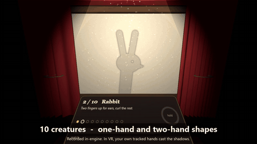
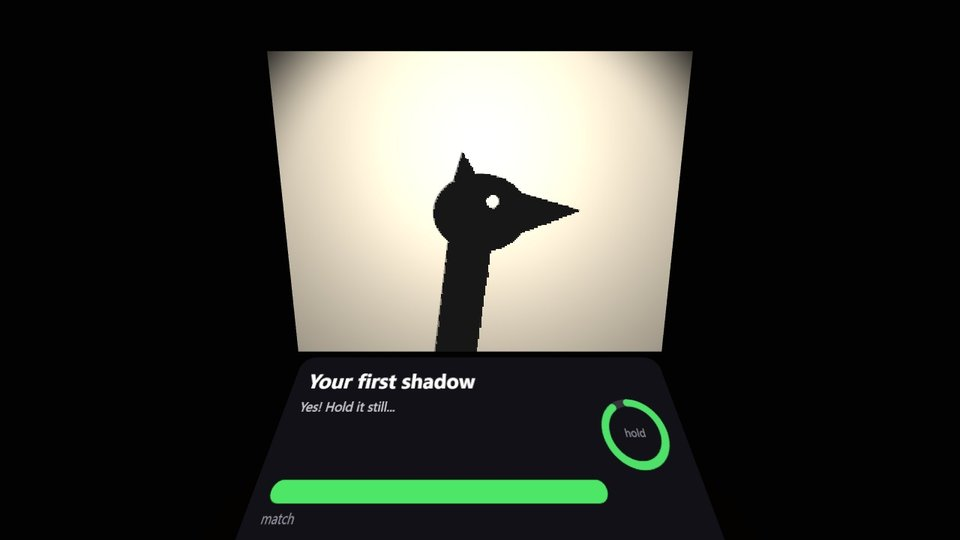
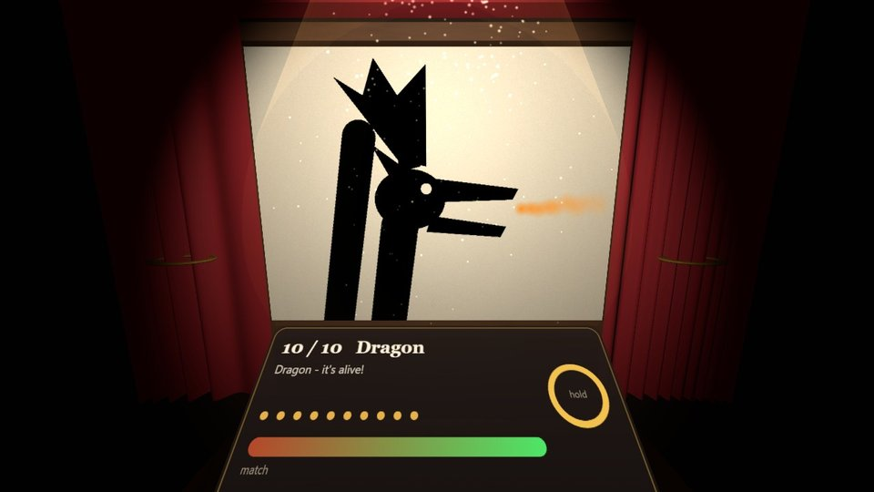
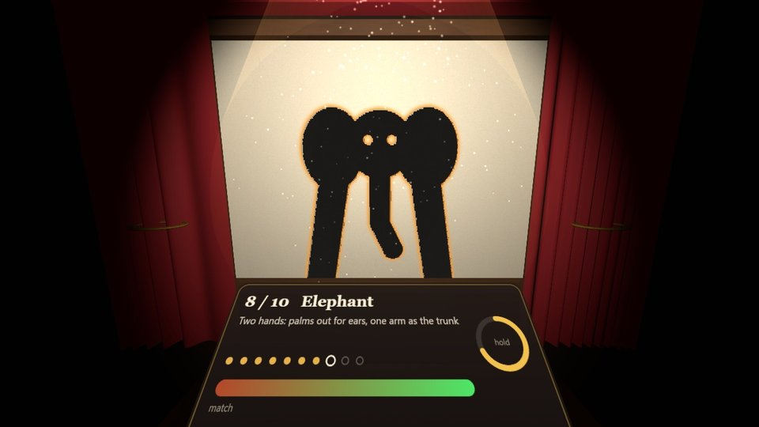
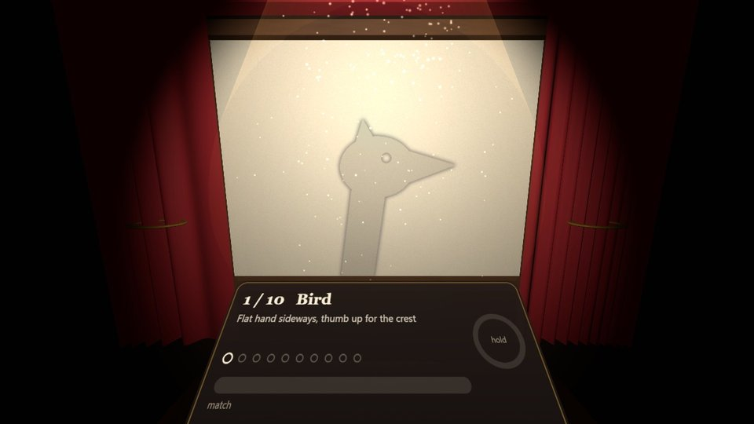

# Shadow Hands

**Hand-shadow puppets, played with your real hands.** Sit under a lamp, shape your hands until their
shadow matches the silhouette on the wall, and hold it, and the shadow comes alive.

### ▶ [Play now: matt869.github.io/shadowHandsVR](https://matt869.github.io/shadowHandsVR/)

No install, no account, nothing uploaded. Two ways to play:

| | How | What you need |
|---|---|---|
| **VR** | Open the link in the **Meta Quest Browser**, press **Enter VR**, put your hand between the lamp and the wall | Meta Quest with hand tracking |
| **Webcam** | Open the link on a laptop or desktop, press **Play with your webcam**, hold your hand up to the camera | Any webcam and a modern browser |

In webcam mode the camera works like the lamp: bring your hand closer to make the shadow bigger.

## Features
- **10 creatures**, from one-hand animals (bird, rabbit, dog, snail, swan, wolf) to two-hand shapes
  (deer, elephant, crab, dragon), none of which need crossed fingers.
- **A 20-second tutorial** on first launch, then Story mode with saved progress.
- **Daily Shadow:** the same puzzle for everyone each day, with a streak.
- **Hold-to-lock:** keep the match for 1.25 s. A forgiving decay copes with shaky tracking.
- **It comes alive:** a warm flash, golden sparks, and the creature hops, howls, sprays water or
  breathes fire.
- **A puppet-theatre stage:** velvet curtains, a paper screen, a brass lamp with a visible beam and dust
  in the light, and a music-box soundtrack.
- **Hands only:** no controllers, seated, everything within arm's reach.

| | |
|---|---|
|  |  |
|  |  |

## How it works
The score is **physical, not a gesture classifier**. A spot light casts your tracked hands onto the
wall, and a small orthographic camera reads the *actual shadow* back from the GPU. The game then
computes the **intersection over union (IoU)** of the shadow and the target silhouette. Any hand shape
that casts the right shadow counts; there's no "correct" pose to memorize.

- **Hands.** In VR, the WebXR hand-tracking joints are built into a solid capsule hand (bones, palm and
  forearm) that casts the shadow. With a webcam, Google's MediaPipe Hand Landmarker finds 21 points per
  hand and maps them onto the same capsule hand.
- **Robust scoring.** Each pixel is compared with the brightest it has ever been, so the lamp's
  fall-off at the edges is never mistaken for shadow. Smoothing and the hold timer run on real time,
  so the game feels the same on fast and slow devices.
- **Offline and private.** three.js and MediaPipe are included in this repo (checksums verified at
  download), so the page loads nothing from other sites. Webcam frames never leave the device.

## Tested
`node Tools/web_selftest.cjs` plays the whole game in headless Chrome with real shadows: the tutorial,
all 10 levels, Daily mode, Skip and saved progress, pause and resume, rejecting a wrong shape, a VR hand
built from joint data, the real MediaPipe model loading, and a webcam hand casting a shadow. Add
`SH_URL=https://matt869.github.io/shadowHandsVR/` to test the live site. **All checks pass.**

`node Tools/web_xrtest.cjs` tests the **VR code path** with Meta's Immersive Web Emulation Runtime
(IWER) on an emulated **Meta Quest 3** with hand tracking:
- entering VR and recentring,
- tracked hand joints casting a shadow (and the tutorial reacting to it),
- a fingertip poke on a desk button,
- a level locking inside the VR session,
- headset off and back on.

It also checks that **Meta VR Glasses** can enter the session, and the screenshots confirm the whole
stage fits in the glasses' field of view. **All checks pass.**

Not yet tested with real hands on a physical headset. Feedback on which shapes feel too hard is welcome.

## Run it locally
Serve the `docs/` folder with any static server (for example `npx serve docs`) and open it. Webcam
mode needs `localhost` or HTTPS.

| Tool | What it does |
|---|---|
| `node Tools/web_selftest.cjs` | Full automated playthrough (needs `npm i playwright && npx playwright install chromium`) |
| `node Tools/web_xrtest.cjs` | VR-path test on an emulated Quest 3 and Meta VR Glasses (also needs `npm i iwer@2.7.0`) |
| `node Tools/web_video.cjs` | Renders the gameplay video frame by frame, with sound and captions (needs ffmpeg) |
| `python Tools/generate_assets.py` | Regenerates the silhouettes, sounds and music (Pillow and numpy) |

## Also in this repo: a native Quest app (Unity)
`Assets/` holds a Unity 6 + Meta XR SDK 207 version of the same game. Its in-editor self-test passes
33/33, and it builds a release-signed APK with `bash Tools/build_release.sh`. See
[CHANGELOG.md](CHANGELOG.md) and [MANUAL_STEPS.md](MANUAL_STEPS.md).

## Credits
- Game, code, silhouettes and all sounds and music: **matt869**. The art and audio are generated by
  `Tools/generate_assets.py`.
- [three.js](https://threejs.org) 0.169.0, MIT License (`docs/vendor/three.LICENSE.txt`).
- [MediaPipe](https://github.com/google-ai-edge/mediapipe) Tasks Vision 1.2.0 and the Hand Landmarker
  model, Apache License 2.0 (`docs/vendor/mediapipe/NOTICE.txt`).
